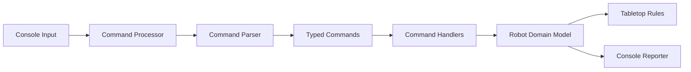

# Toy Robot Simulator Design

## 1. Architecture Overview

This design is intentionally minimal and suited to a small C# console application. It separates the rules of the tabletop and robot state from the mechanics of command parsing and console I/O.

The final solution is implemented as a small layered architecture with a domain layer and a console adapter layer:

- Domain layer: owns robot state, board rules, command parsing, and command execution
- Console layer: reads input lines and prints REPORT output
- Test project: verifies the domain rules and command sequences without depending on the terminal

The design keeps the core logic testable without depending on console input or output, which ensures deterministic unit testing.



## 2. Component Responsibilities

### 2.1 Robot model
Responsibilities:
- store whether the robot is placed
- store the current `Position`
- store the current facing `Direction`
- apply LEFT and RIGHT rotation rules
- apply MOVE validation and movement rules
- produce a REPORT-ready state snapshot

The robot model should not read user input directly and should not know how the console is implemented.

### 2.2 Tabletop model
Responsibilities:
- define the valid board bounds: X = 0..4 and Y = 0..4
- determine whether a position is inside the tabletop
- determine whether a proposed move would leave the board

The tabletop should be the single source of truth for board validity.

### 2.3 Command parser
Responsibilities:
- accept a raw command string
- convert it into a typed command object
- validate syntax and arguments for PLACE
- return `null` or an invalid result when the input cannot be parsed

This keeps raw string parsing separate from robot behavior and makes the system easier to extend.

### 2.4 Command processor
Responsibilities:
- parse raw input into a typed command
- route the parsed command to the correct handler
- execute valid command logic
- ignore malformed or unsupported commands without changing robot state
- preserve command sequence order

The processor is responsible for enforcing the no-op rule for invalid commands and commands issued before the first valid PLACE.

### 2.5 Command handlers
Responsibilities:
- implement the behavior for one command type each
- validate whether the handler can process a specific command
- execute the command and return a result payload

This keeps the design open for extension without modifying the central dispatch logic each time a new command is added.

### 2.6 Input and output adapters
Responsibilities:
- read command sequences from the console, a file, or a test harness
- pass each command to the command processor
- print valid REPORT output

These adapters remain thin and side-effectful, with minimal business rules beyond formatting output.

## 3. Domain Model and State Representation

### 3.1 Tabletop
Represented as a static utility model with constants:
- `MinX = 0`
- `MaxX = 4`
- `MinY = 0`
- `MaxY = 4`

Methods:
- `IsValidPosition(int x, int y): bool`
- `CanMoveFrom(int x, int y, Direction direction): bool`

### 3.2 Orientation
Use a fixed enum:
- `North`
- `East`
- `South`
- `West`

Direction transitions:
- LEFT rotation: `North -> West -> South -> East -> North`
- RIGHT rotation: `North -> East -> South -> West -> North`

### 3.3 Position representation
The solution uses a value object:
- `Position(int X, int Y)`

This keeps coordinate handling explicit and prevents the robot state from being spread across unrelated fields.

### 3.4 Robot state
The robot state is represented explicitly as:
- `IsPlaced: bool`
- `Position: Position`
- `Facing: Direction?`

This model makes the rules straightforward:
- before placement: `IsPlaced = false`
- after valid PLACE: `IsPlaced = true` and the position and direction are set
- after invalid PLACE: state unchanged
- after MOVE beyond boundary: state unchanged

## 4. Command Processing Flow

The command processing flow is deterministic and linear:

1. Receive a raw command string from the input adapter.
2. Parse the string into a typed command object.
3. If parsing fails, ignore the command.
4. Find the matching handler for that command type.
5. Execute the handler if it can process the command.
6. If the command is valid, apply the operation to the robot.
7. If the command is REPORT, return the current state as `X,Y,ORIENTATION`.

Pseudo-flow:

- `PLACE X,Y,F`
  - validate X, Y, and F
  - validate within bounds
  - if valid: set robot state
  - else: ignore command

- `MOVE`
  - if robot not placed: ignore
  - determine new position based on current facing direction
  - if new position remains in bounds: update X/Y
  - else: ignore

- `LEFT`
  - if robot not placed: ignore
  - rotate facing direction 90 degrees counterclockwise

- `RIGHT`
  - if robot not placed: ignore
  - rotate facing direction 90 degrees clockwise

- `REPORT`
  - if robot not placed: ignore
  - otherwise output `X,Y,ORIENTATION`

## 5. Key Types and Contracts

The design keeps interfaces small and direct while supporting extension.

```csharp
public record Command;
public record PlaceCommand(int X, int Y, Direction Direction) : Command;
public record MoveCommand : Command;
public record LeftCommand : Command;
public record RightCommand : Command;
public record ReportCommand : Command;

public interface ICommandHandler
{
    bool CanHandle(Command command);
    Result<string?> Execute(Robot robot, Command command);
}

public static class CommandParser
{
    public static Command? Parse(string? rawCommand);
}

public class CommandProcessor
{
    public string? Process(string? commandText);
}
```

These contracts are intentionally narrow and should be implemented without unnecessary framework overhead.

## 6. Error-Handling Strategy

The specification requires invalid commands to be ignored without altering robot state. Therefore:

- parse failures are treated as no-ops
- unsupported commands are ignored
- invalid PLACE arguments are ignored
- boundary-crossing MOVE operations are ignored
- commands received before the first valid PLACE are ignored

The design should not throw exceptions for routine invalid input. The command processor should leave the robot state unchanged and return no valid report for invalid operations.

This matches the assessment requirement to ignore invalid commands rather than fail loudly.

## 7. Testing Strategy

Unit tests should target the robot and tabletop logic directly, without requiring console input or output.

Recommended test structure:

- Tabletop tests
  - valid coordinate inside bounds
  - invalid coordinate outside bounds
  - edge and corner boundary cases

- Robot state tests
  - unplaced robot ignores MOVE/LEFT/RIGHT/REPORT
  - valid PLACE sets position and direction
  - repeated PLACE overwrites state

- Rotation tests
  - LEFT and RIGHT rotate correctly through all directions
  - wraparound between NORTH and WEST/EAST is verified

- Movement tests
  - move inside board succeeds
  - move beyond edge is ignored
  - corner and edge scenarios are covered

- Command processor tests
  - invalid command is ignored
  - malformed PLACE is ignored
  - REPORT after valid placement returns formatted string

A unit test can directly call methods such as `robot.Place(...)`, `robot.Move()`, `robot.TurnLeft()`, and `robot.Report()` without console interaction. This keeps the logic deterministic and independent of I/O.

## 8. Important Design Decisions and Rationale

### 8.1 Keep the model simple
A small console application does not need a heavy framework or large abstraction layer. A direct object model is simpler and easier to verify.

### 8.2 Separate state from IO
The robot and tabletop must be pure domain logic; console input/output is only a thin adapter. This allows unit tests to validate rules without interacting with the terminal.

### 8.3 Validate early and ignore invalid commands
The core design decision is to ignore invalid commands instead of raising errors. This is required by the approved specification and simplifies state management.

### 8.4 Centralize board validity rules
All boundary checks should be performed by the tabletop model, not by the robot itself. This avoids duplicate validation logic and reduces the chance of inconsistent rules.

### 8.5 Prefer explicit enum-based orientation
Using an enum keeps orientation handling unambiguous and prevents invalid values from reaching the movement logic.

### 8.6 Use typed commands and handler-based dispatch
This keeps command parsing and command execution separate. It helps the solution remain extensible without turning the processor into a single large conditional block.

## 9. Requirements-to-Component Mapping

| Requirement ID | Responsible Component | Notes |
| --- | --- | --- |
| FR-001, BR-001, BR-009 | Tabletop model | Defines valid coordinates and edge/corner bounds. |
| FR-002, BR-002 | Robot model / Orientation enum | Defines valid orientations. |
| FR-003, BR-003, AC-001, AC-010 | Robot model + Command processor | Enforces pre-placement no-op rules. |
| FR-004, FR-005, AC-002, AC-003, AC-004 | Command parser + Command processor + Robot model | Validates and applies PLACE. |
| FR-006, BR-004, AC-007, AC-008, AC-013 | Tabletop model + Robot model | Prevents boundary-crossing moves. |
| FR-007, FR-008, AC-005, AC-006 | Robot model | Defines LEFT/RIGHT rotation semantics. |
| FR-009, BR-008, AC-009 | Robot model + Console reporter | Produces X,Y,ORIENTATION output. |
| FR-010, BR-006, BR-007, AC-012 | Command processor + parser | Ignores malformed and unsupported commands. |
| FR-011, FR-012, AC-011 | Robot model + Command processor | Persists state and allows repeated PLACE. |
| FR-013 | Command processor | Processes commands serially and applies only valid mutations. |

## 10. Specification Gap Check

No genuine specification gap is identified in the approved requirements. The design therefore follows the approved contract directly and does not propose additional features or changes.

If a future review reveals a requirement ambiguity not already identified as a pending decision, the design should pause and the requirement shall be clarified before implementation begins.
